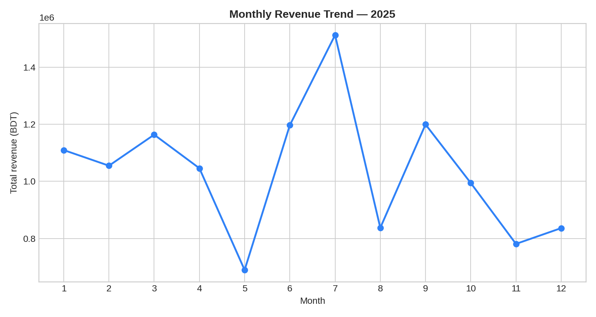
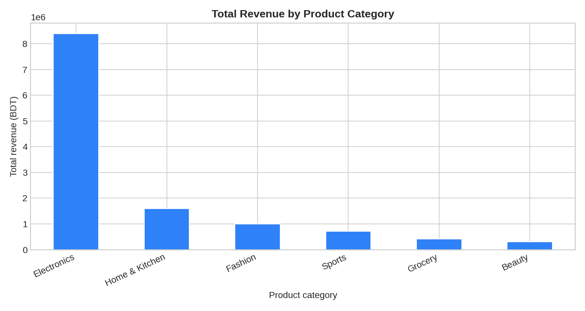

# E-commerce Sales Analysis

A complete beginner-friendly **Data Science project** built with **Pandas, NumPy and Matplotlib**. It analyses a year of online store orders from Bangladesh — which months, product categories, cities and payment methods drive revenue, and how discounts relate to order value.

📖 **New here?** Read the full step-by-step explanation of everything in this project: [PROJECT_GUIDE.md](PROJECT_GUIDE.md)

> The dataset in this project is synthetic practice data generated with NumPy. It is made for learning the full workflow: data generation → cleaning → analysis → visualization → insights.

## Project Highlights

- Generate a realistic e-commerce order dataset with **NumPy**
- Clean and explore data with **Pandas**
- Create summary tables with `groupby`, aggregation and correlation
- Build clear visualizations with **Matplotlib**
- Save charts, tables and written insights automatically

## Questions This Project Answers

1. Which month of 2025 had the highest total revenue?
2. Which product category earns the most revenue?
3. Which city places the most valuable orders?
4. Which payment method do customers use most?
5. Do bigger discounts mean higher or lower revenue per order?

## Dataset Columns

| Column | Meaning |
|---|---|
| `order_id` | Order ID, e.g. ORD-001 |
| `order_date` | Date the order was placed (2025) |
| `month` | Month of the order, 1–12 |
| `product_category` | Electronics / Fashion / Grocery / Home & Kitchen / Beauty / Sports |
| `unit_price_bdt` | Price of one item in BDT |
| `quantity` | Number of items in the order, 1–5 |
| `discount_percentage` | Discount applied, 0–40% |
| `payment_method` | Cash on Delivery / bKash / Nagad / Card |
| `city` | Delivery city |
| `delivery_days` | Delivery time in days, 1–7 |
| `revenue_bdt` | Order revenue = unit price × quantity × (1 − discount) |

## Project Structure

```text
ecommerce-sales-analysis/
├── README.md
├── requirements.txt
├── data/
│   └── ecommerce_sales_dataset.csv
├── src/
│   ├── generate_dataset.py
│   └── analysis.py
├── notebooks/
│   └── ecommerce_sales_analysis.ipynb
└── outputs/
    ├── insights.md
    ├── tables/
    │   ├── summary_statistics.csv
    │   ├── monthly_revenue.csv
    │   ├── revenue_by_category.csv
    │   ├── revenue_by_city.csv
    │   └── correlation_matrix.csv
    └── charts/
        ├── monthly_revenue_trend.png
        ├── revenue_by_category.png
        ├── orders_by_payment_method.png
        └── discount_vs_revenue.png
```

## Quick Start

```bash
pip install -r requirements.txt
python src/generate_dataset.py
python src/analysis.py
```

After running the analysis, open:

- `outputs/insights.md` for the key findings
- `outputs/charts/` for all visualizations
- `outputs/tables/` for the summary CSV files

## Sample Visualizations





## Tools Used

- **Python**
- **Pandas** — data cleaning, grouping and analysis
- **NumPy** — synthetic data generation, trend line and numerical work
- **Matplotlib** — charts

## Future Improvements

- Replace the synthetic dataset with real store order data
- Add customer-level analysis (repeat buyers, average basket size)
- Train a simple Machine Learning model with scikit-learn to predict order revenue
- Build an interactive dashboard with Streamlit

## Note

This project is for Data Science practice. The data is synthetic, so the findings demonstrate the workflow only — they are not real business results.
